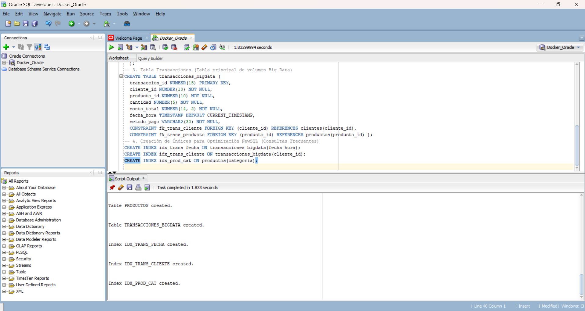
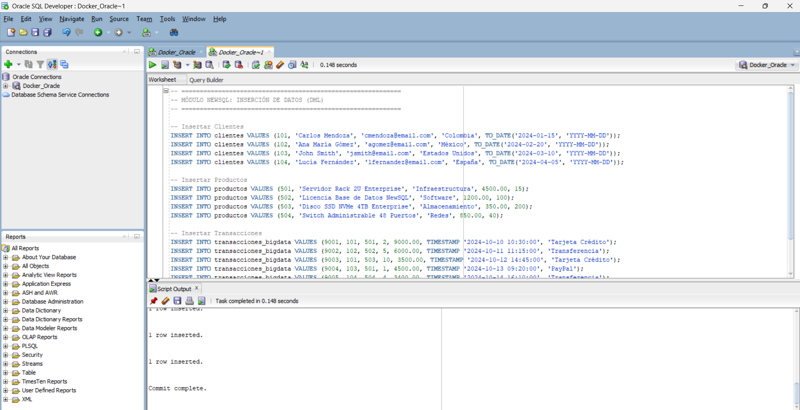
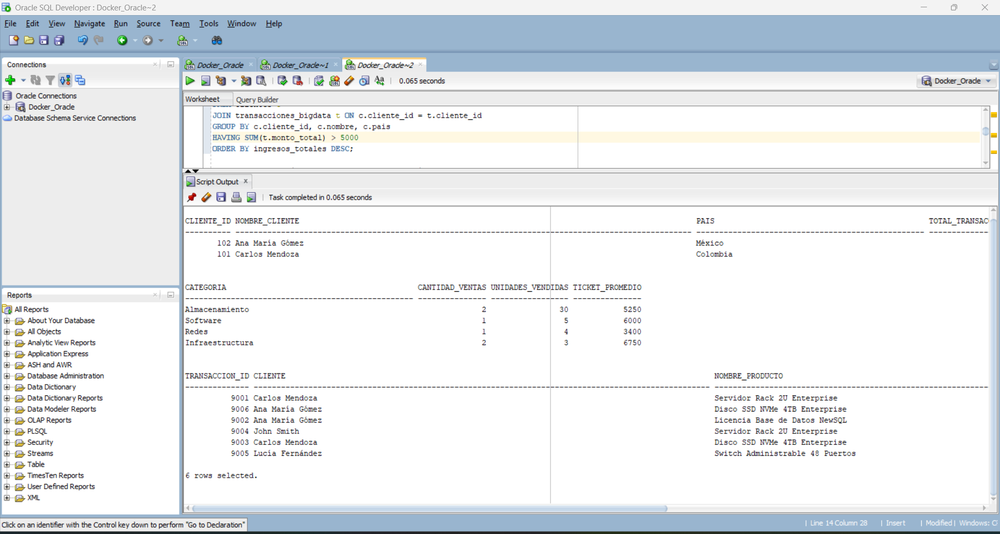
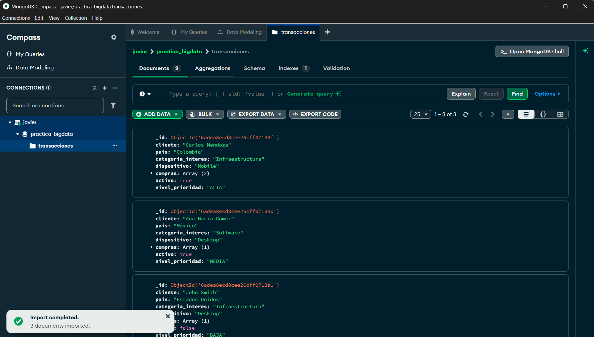
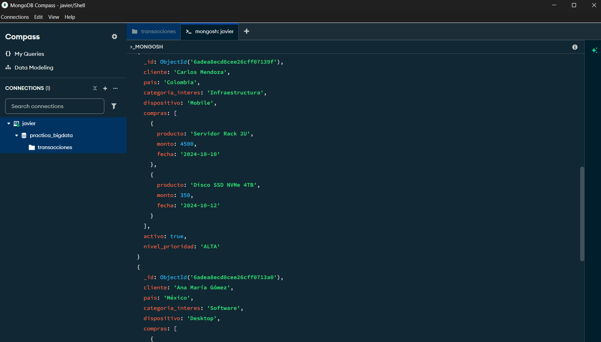

# Evidencias Visuales del Desarrollo Práctico 
En esta sección se presentan las capturas de pantalla que certifican la ejecución secuencial y exitosa de las prácticas en los entornos **NewSQL (Oracle SQL Developer)** y **NoSQL (MongoDB Compass)**. 

## Módulo NewSQL — Oracle SQL Developer 

### 1. Creación de Estructura de Datos (DDL) 

 

* **Descripción:** Ejecución exitosa del script `01_ddl_tablas.sql` evidenciando la creación de las tablas `CLIENTES`, `PRODUCTOS` y `TRANSACCIONES_BIGDATA`, junto con la definición de claves primarias, foráneas e índices de optimización. 

### 2. Inserción y Confirmación de Datos (DML) 

 

* **Descripción:** Ejecución de `02_dml_datos.sql` poblando las tablas con registros de prueba y confirmación de la transacción mediante el comando `COMMIT`. 

### 3. Consultas Analíticas Avanzadas 

 

* **Descripción:** Resultados devueltos en la pestaña *Query Result* al ejecutar consultas relacionales complejas con `JOIN`, agregaciones `GROUP BY` y funciones analíticas de ventana (`DENSE_RANK`). 

##  Módulo NoSQL — MongoDB Compass 

### 4. Importación y Visualización de Colecciones JSON 

 

* **Descripción:** Visualización gráfica en MongoDB Compass de la base de datos `practica_bigdata` y la colección `transacciones` tras importar el archivo `coleccion_datos.json`. 

### 5. Consultas CRUD y Pipelines de Agregación 
 

* **Descripción:** Ejecución de filtros de búsqueda (`find`), actualización de documentos (`$set`) y pipelines de agregación (`$unwind`, `$group`, `$sort`) en la consola `_MONGOSH`.